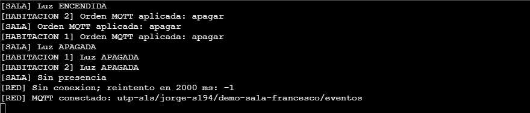

# Pruebas de la etapa 3

Escenarios obligatorios de la guía del Avance 3. Cada fila indica cómo se
provoca el escenario, qué se espera y qué se observó. Las filas marcadas como
*Pendiente* aún no tienen evidencia registrada.

**Entorno común:** simulación de Wokwi (<https://wokwi.com/projects/481354390861628417>),
dispositivo `demo-sala-francesco`, broker `broker.emqx.io:1883` y receptor iniciado con:

```powershell
.\.venv\Scripts\python.exe -u -m backend.main --broker broker.emqx.io --prefijo utp/ds8/1gs133/sls-smart-lighting --dispositivo-comandos demo-sala-francesco --puerto 8018
```

## Resumen

| # | Escenario | Cómo se provoca | Resultado esperado | Resultado observado | Estado |
|---|---|---|---|---|---|
| 1 | Funcionamiento normal | Iniciar Wokwi y el receptor | Telemetría cada 2 s; monitor en `ONLINE` | — | Pendiente |
| 2 | Orden válida | Enviar `{id, zona, accion}` válido desde el dashboard | El LED de la zona cambia y la telemetría lo confirma | — | Pendiente |
| 3 | Orden inválida | Publicar una zona o acción no admitida en `.../comandos` | `[RED] Orden rechazada` en consola; los LED no cambian | — | Pendiente |
| 4 | Caída del Wi-Fi o broker con recuperación | Pausar la simulación unos 60 s y reanudarla | `SIN_DATOS` a los 6 s, `OFFLINE` por Last Will y `ONLINE` al reanudar, sin reiniciar | `SIN_DATOS` a los 6 s, `OFFLINE` a los 50 s y `ONLINE` al reanudar; misma sesión `74e6ec99` | **Aprobada** (23-11-2026) |
| 5 | Dato inválido al receptor | Publicar JSON mal formado en `.../telemetria` | El receptor lo rechaza y no lo guarda en CSV | — | Pendiente |
| 6 | Reinicio del dispositivo | Detener e iniciar Wokwi | Sesión nueva; `online` retenido; monitor vuelve a `ONLINE` | — | Pendiente |
| 7 | Dispositivo conectado que deja de publicar | — | Monitor en `SIN_DATOS` tras 6 s | Cubierto en parte por la fase 1 de la prueba 4 | Pendiente |
| 8 | Detención de la simulación | Pulsar *Stop* en Wokwi | `OFFLINE` por Last Will | — | Pendiente |

## Prueba 4: caída de la conexión y recuperación sin reiniciar

**Objetivo.** Comprobar que el dispositivo recupera la conexión MQTT por sí solo,
sin reiniciar la simulación, y que el monitor refleja cada fase de la caída.

**Procedimiento.**

1. Iniciar el receptor (una sola instancia) y el dashboard en *Modo conectado*.
2. Iniciar la simulación y esperar a `[RED] MQTT conectado` en la consola de Wokwi.
3. Pausar la simulación (botón de pausa, no *Stop*) durante al menos 60 s.
4. Reanudar la simulación y observar la consola de Wokwi y el monitor.

**Registro del monitor** (`backend/datos/eventos_comunicacion.csv`, hora de Panamá):

| Hora | Estado | Nivel | Detalle |
|---|---|---|---|
| 21:43:39 | — | — | Última telemetría antes de la pausa |
| 21:43:45 | `SIN_DATOS` | ADVERTENCIA | Sin telemetría válida durante al menos 6000 ms |
| 21:44:29 | `OFFLINE` | ERROR | Last Will recibido |
| 21:47:10 | `ONLINE` | INFO | Telemetría válida recibida tras reanudar |

**Análisis.**

- **`SIN_DATOS` a los 6 s.** El monitor usa `max(6000 ms, 3 × intervalo)`; con
  telemetría cada 2 s, el umbral es de 6 s (`backend/monitor.py`).
- **`OFFLINE` a los 50 s.** Con la simulación congelada, el broker deja de recibir
  paquetes. Al vencer el keepalive (30 s × 1,5 = 45 s) cierra la sesión y publica
  el Last Will `offline` que el firmware registró al conectarse (`firmware/red.py`).
- **`ONLINE` al reanudar.** El primer envío falla y el bloque `except` de
  `ServicioRed.paso()` cierra el socket y programa un reintento con espera
  exponencial (2 s, 4 s, 8 s… hasta 60 s). Al reconectar, vuelve a registrar el
  Last Will, se suscribe a `comandos` y publica `online`.
- **No hubo reinicio.** La sesión es `74e6ec99` antes y después. El firmware genera
  una sesión aleatoria en cada arranque (`os.urandom(4)`), así que un reinicio
  habría producido otro valor.
- **El control local no se detuvo.** El ciclo de sensores no usa la red: solo deja
  datos en la cola y en la instantánea, y el hilo de red es el único que publica.

**Repetición.** La prueba se repitió con el mismo resultado: `SIN_DATOS` a las
21:53:48, `OFFLINE` a las 21:54:31 y `ONLINE` a las 21:54:44, con la sesión `74e6ec99`.

Las horas están en hora de Panamá (UTC−5). El CSV del monitor las guarda en UTC,
por lo que allí aparecen 5 horas más tarde (por ejemplo, 02:43 en lugar de 21:43).

**Evidencia.** Consola de Wokwi al reanudar: el primer envío falla con `-1`
(socket cerrado por el broker), se programa el reintento a 2 s y MQTT vuelve a
conectar sin reiniciar la placa.



**Limitación observada.** La tarjeta *Conexión del hogar* del dashboard muestra el
estado de la conexión entre el receptor y el broker, no el estado del dispositivo.
Durante el `OFFLINE` siguió indicando *Conectado · MQTT activo · sin eventos
recientes*. Los estados `SIN_DATOS` y `OFFLINE` del monitor solo se ven en la
consola del receptor y en `eventos_comunicacion.csv`.
