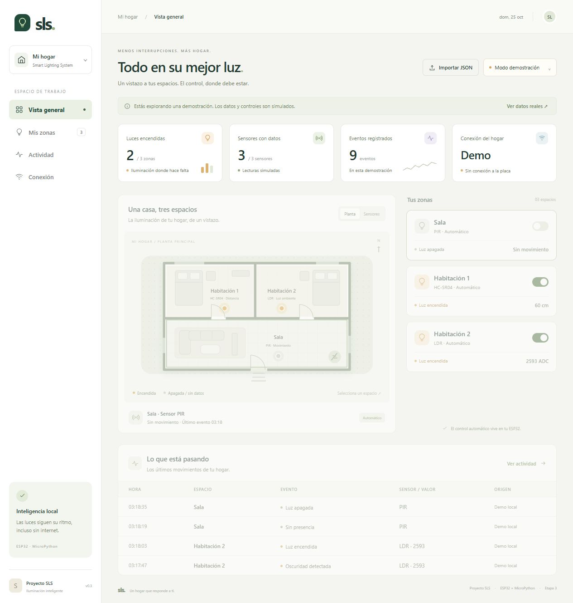

# Avance de Etapa 3 · Francesco

Este avance se propone en un PR **en borrador**, dependiente del PR #11.
No está listo para merge ni sustituye la validación del sistema completo.

## Verificación automatizada

Verificación local del 25 de octubre de 2026:

| Comando | Resultado |
|---|---|
| `python tests/prueba_main.py` | Correcto: dos IRQ, 16 eventos, LEDs apagados y CSV equivalente al historial |
| `python -m unittest discover -s tests -p prueba_red.py` | 12 pruebas correctas |
| `python -m unittest discover -s tests -p test_backend_dashboard.py` | 11 pruebas correctas |
| `node --test tests/test_dashboard.mjs` | 6 pruebas correctas |
| `git diff --check` | Sin errores |

Las pruebas de red y del receptor MQTT usan dobles de prueba: no prueban un broker
externo ni conectividad del ESP32. Las pruebas HTTP solo usan loopback.

## Wokwi: evidencia aportada por el usuario

El usuario ejecutó los módulos en Wokwi y compartió capturas durante la revisión:

- Control local con la red desactivada: sala por PIR, Habitación 1 por distancia
  y Habitación 2 por LDR. El diagrama conserva sus tres LEDs asignados.
- `mensajes.evento(...)` desde la REPL: JSON con zona, sensor, valor numérico,
  luz booleana, versión, dispositivo, sesión, secuencia y tiempo.
- Con `broker-prueba.invalid`: timeout inicial de WiFi, errores posteriores
  de conexión y reintentos. La consola muestra encendido/apagado de sala durante
  los fallos. Estas capturas no prueban recepción de mensajes MQTT ni el
  comportamiento de todas las zonas tras cada tipo de caída.

La configuración versionada permanece con `HABILITAR_RED = False` y
`MQTT_SERVIDOR = ""`. No hay broker ni credenciales reales configurados.

## Dashboard

Se verificó en el navegador local: navegación, modo demo, estado vacío del modo
conectado, apagado simulado de todas las zonas, filtros combinados de historial
y presentación móvil a 390 px. La consola del navegador no mostró errores.

La demostración es ficticia y está separada del almacenamiento del backend.
Los interruptores reales están deshabilitados; el firmware no recibe comandos.

## Pendientes antes de integrar

- Validar ESP32/Wokwi → broker elegido → backend → dashboard y reconexión real.
- Coordinar con el PR #9 (`feat/backend-api-mqtt`): incluye otro backend y su
  contrato no coincide aún con esta propuesta. No se ha fusionado ni reemplazado.
  Hay que acordar rutas HTTP, identificadores de zona y tópicos MQTT.
- Revisar el alcance: este PR de avance reúne firmware, backend, dashboard y
  documentación, y supera el tamaño recomendado por la guía. Se recomienda
  dividir o acordar la integración por capas antes de marcarlo listo para revisión.
- Autenticación/TLS, comandos a la placa y despliegue en nube siguen pendientes.
- Revisión humana por alguien distinto del autor, que debe comprender y poder
  explicar el código. Se utilizó asistencia de IA en implementación y pruebas.
