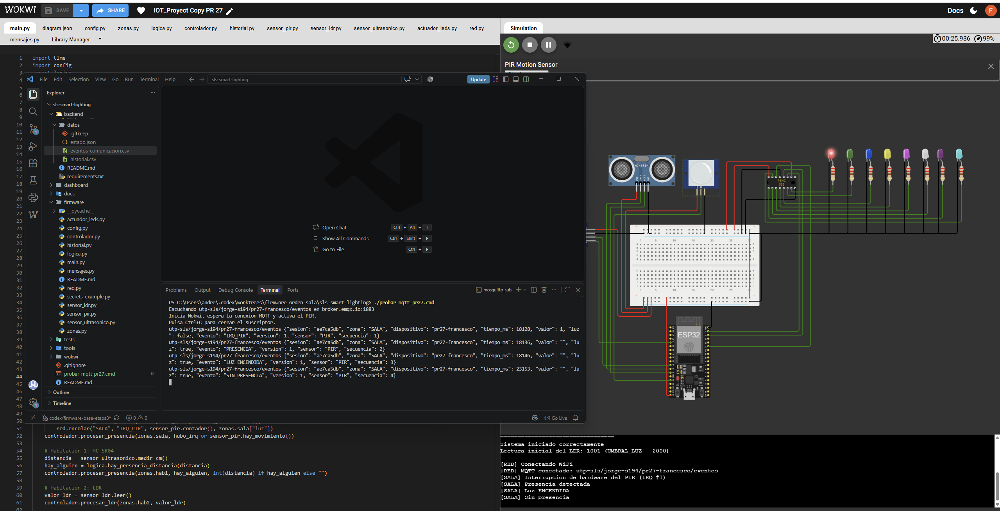
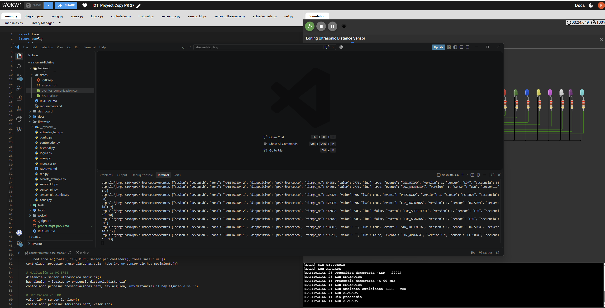

# Validación del firmware base de la Etapa 3

## Pruebas locales

Desde la raíz del repositorio, ejecutar en PowerShell:

```powershell
python tests/prueba_main.py
python -m unittest discover -s tests -p "prueba_*.py" -v
```

La simulación registró 2 interrupciones del PIR y 16 eventos. Los LEDs
terminaron apagados y el CSV coincidió con el historial en memoria. Las 12
pruebas automatizadas terminaron con `OK`.

## Demostración en Wokwi y MQTT

1. Abrir la [copia de Wokwi del PR #27](https://wokwi.com/projects/480357955072540673).
2. Con Eclipse Mosquitto instalado, ejecutar `./probar-mqtt-pr27.cmd` desde
   la raíz del repositorio. El lanzador escucha
   `utp-sls/jorge-s194/pr27-francesco/eventos` en `broker.emqx.io:1883`.
3. Iniciar Wokwi, esperar `[RED] MQTT conectado` y repetir estos casos.

| Zona | Acción | Resultado observado |
|---|---|---|
| Sala | Simular movimiento y esperar que termine | LED rojo encendido, seguido de apagado. MQTT recibió `IRQ_PIR`, `PRESENCIA`, `LUZ_ENCENDIDA`, `SIN_PRESENCIA` y `LUZ_APAGADA`. |
| Habitación 1 | Acercar el objeto a 60 cm y luego alejarlo | MQTT recibió `LUZ_ENCENDIDA`, `SIN_PRESENCIA` y, aproximadamente 5 segundos después, `LUZ_APAGADA`. |
| Habitación 2 | Reducir la luz y luego aumentarla | Con ADC 2771, el firmware detectó oscuridad y encendió la luz. Con ADC 905, publicó `LUZ_SUFICIENTE` y `LUZ_APAGADA`. |




