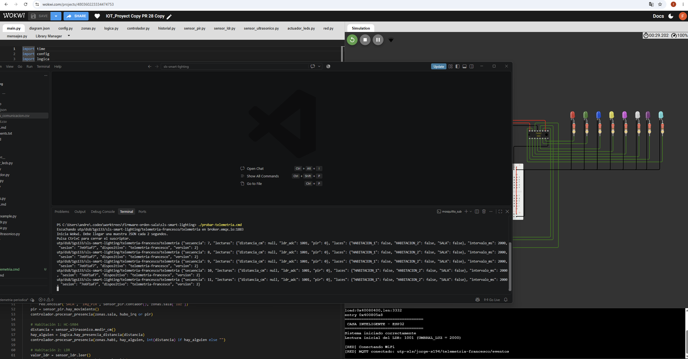
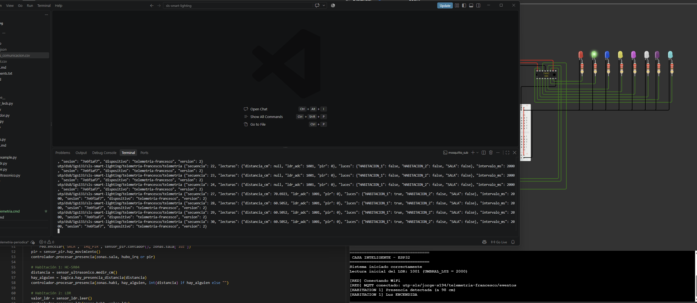

# Validación de la telemetría periódica

Desde la raíz del repositorio, ejecutar en PowerShell:

```powershell
python tests/prueba_main.py
python -m unittest discover -s tests -p "prueba_*.py" -v
```

Pasaron las 13 pruebas. La simulación local registró dos interrupciones del PIR
y 16 eventos. Los LEDs terminaron apagados y el CSV coincidió con el historial
en memoria.

1. Con Eclipse Mosquitto instalado, ejecutar `./probar-telemetria.cmd`.
2. Iniciar la [copia de Wokwi](https://wokwi.com/projects/480360223334474753).
3. Dejar los sensores quietos y comprobar que llegan muestras JSON v2 con
   `intervalo_ms: 2000` y secuencia creciente.
4. Acercar el objeto del ultrasónico a 60 cm. Comprobar que la siguiente muestra
   indique una distancia cercana a 60 cm y `luces.HABITACION_1: true`.

La primera captura muestra las secuencias 7 a 11 con los sensores quietos.
La segunda muestra el cambio de `distancia_cm: null` a aproximadamente 60,5 cm
y el LED verde encendido. Solo se retocó la marca de activación de Windows.




