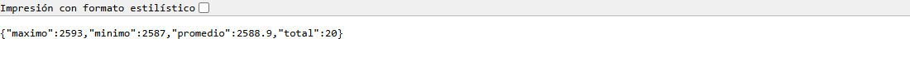
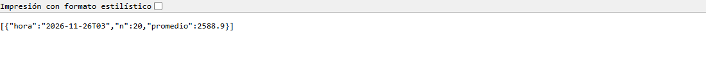
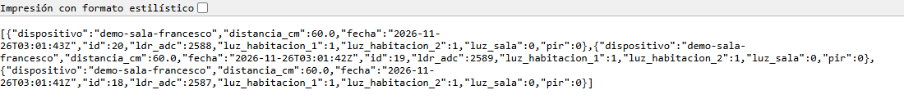
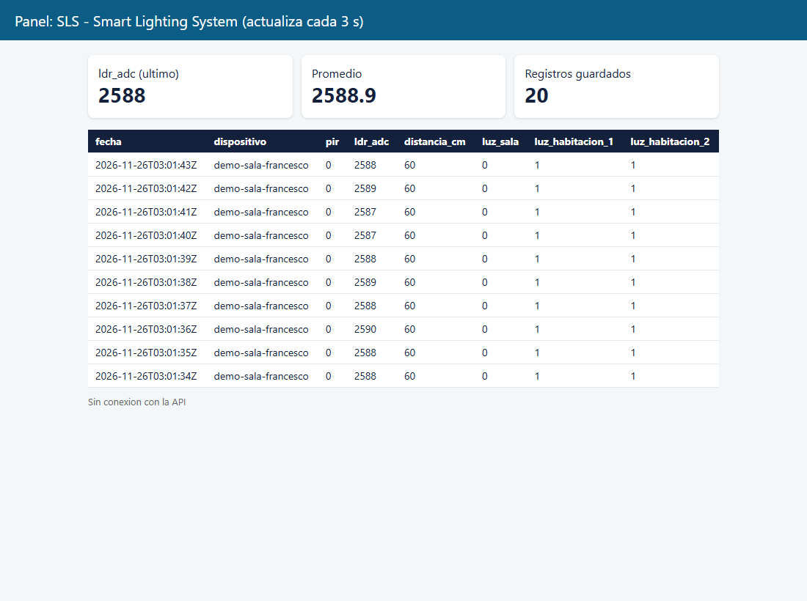
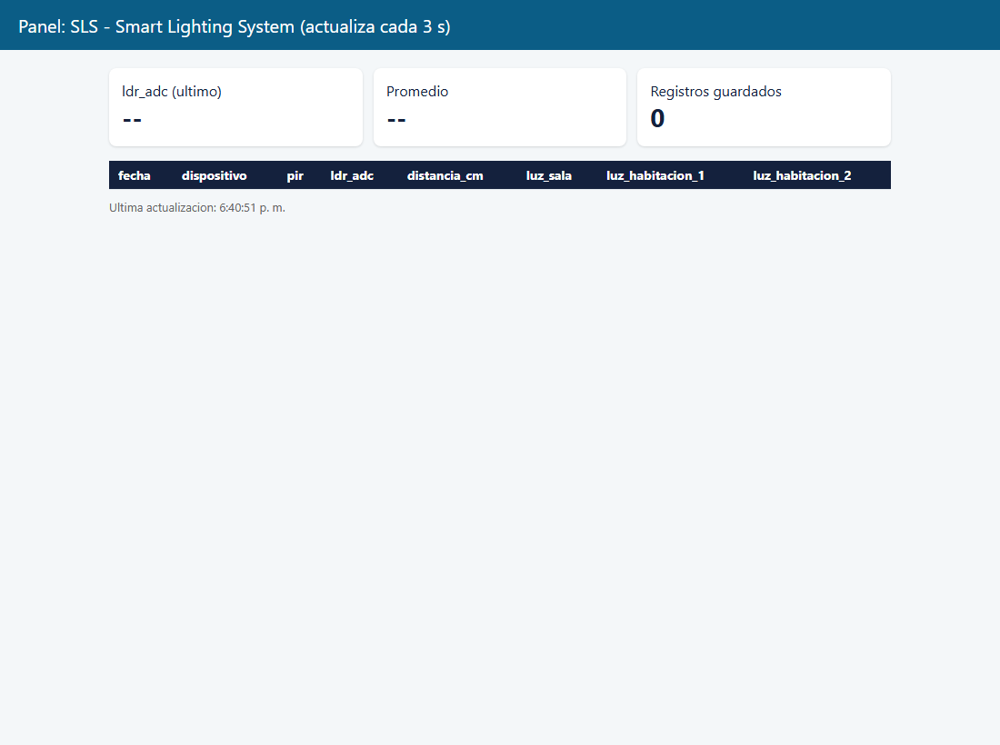
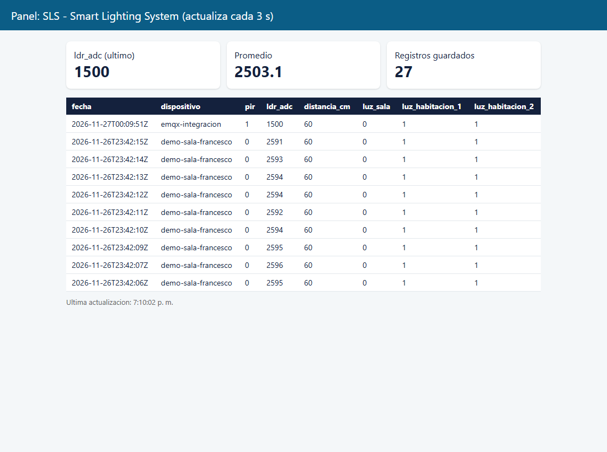
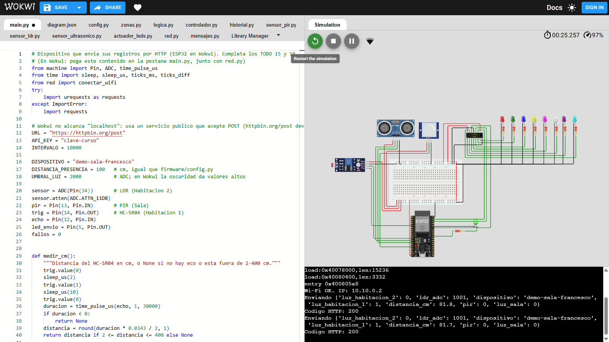
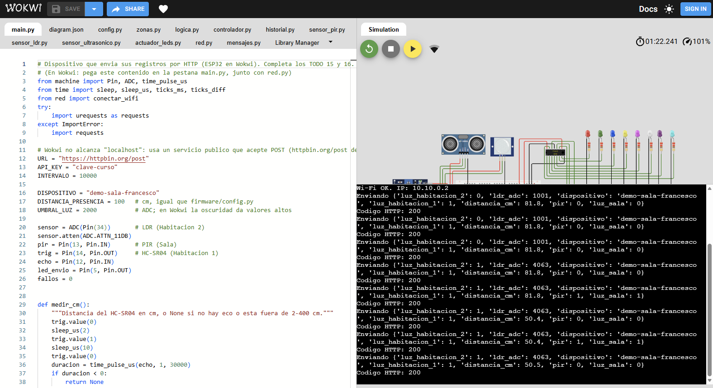
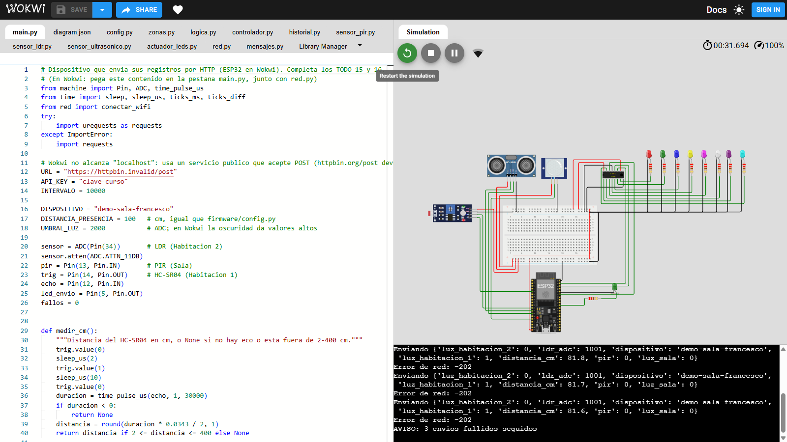

# Laboratorio 13–14 — Persistencia y API REST de nuestro proyecto

**Universidad Tecnológica de Panamá · Facultad de Ingeniería de Sistemas Computacionales**
**Curso:** Desarrollo de Software VIII · **Grupo:** 1GS133
**Integrantes:** Jorge Sarmiento, Francesco Iemma, Abrahan Tuñón, Rubén Domínguez
**Proyecto:** SLS – Smart Lighting System (iluminación automática de tres zonas de una casa con un ESP32)
**Fechas de las pruebas:** 25 y 26 de noviembre de 2026
**Repositorio en GitHub:** https://github.com/JorgeS194/sls-smart-lighting (carpeta lab_persistencia_api/)
**Proyecto de Wokwi del laboratorio:** https://wokwi.com/projects/481769278345949185

En este laboratorio le agregamos a nuestro proyecto una capa de persistencia y servicios de datos: un ingestor MQTT que guarda en SQLite cada lectura válida, una API REST con Flask que es la única puerta de entrada a esa base, un panel web y el envío HTTP desde el ESP32 en Wokwi. Todo el código está en la carpeta `lab_persistencia_api/` del repositorio, y lo único que describe nuestro proyecto en particular es `proyecto.py`.

---

## 1. Ficha del proyecto

### 1.1 El JSON que publica el firmware

El firmware del proyecto (`firmware/mensajes.py`, función `telemetria()`) publica cada 2 s un mensaje como este (ejemplo del contrato del equipo, `docs/CONTRATO_ETAPA3.md`):

```json
{"version":2,"dispositivo":"casa-01","sesion":"demo-01","secuencia":1,"intervalo_ms":2000,
 "lecturas":{"pir":0,"ldr_adc":2593,"distancia_cm":60},
 "luces":{"SALA":false,"HABITACION_1":true,"HABITACION_2":true}}
```

La función también agrega `modos` y `ordenes`. Ese mensaje no sirve tal cual para el laboratorio, por cuatro razones:

- **Está anidado** (`lecturas` y `luces` son objetos), y el laboratorio guarda una fila plana con una columna por campo.
- **Las luces son booleanos** (`true`/`false`). La guía pide que un estado de encendido o apagado sea un entero con valores permitidos `[0, 1]`, y nuestro `validar` rechaza los `bool` a propósito (en Python `True == 1`).
- **`distancia_cm` puede ser `null`**: el firmware la anula si no hay eco o si queda fuera de 2–400 cm. Por eso en la ficha es opcional.
- **El broker y el tema son otros**: el firmware publica en `utp/ds8/1gs133/sls-smart-lighting/<dispositivo>/telemetria` en `broker.emqx.io`, y el laboratorio usa `utp/ds8/<usuario>/sls-smart-lighting/telemetria` en el broker del curso.

Por eso aplanamos el mensaje. El `EJEMPLO` de `proyecto.py` quedó así:

```json
{"dispositivo": "demo-sala-francesco", "pir": 0, "ldr_adc": 2593, "distancia_cm": 60.0,
 "luz_sala": 0, "luz_habitacion_1": 1, "luz_habitacion_2": 1}
```

### 1.2 Campos

| Campo | Tipo | Obligatorio | Rango o permitidos | Qué representa |
|---|---|---|---|---|
| `dispositivo` | texto | Sí | texto libre, no vacío | Identificador del ESP32 |
| `pir` | entero | Sí | `[0, 1]` | Movimiento en la Sala (PIR, GPIO13) |
| `ldr_adc` | entero | Sí | 0 a 4095 | Lectura del LDR de la Habitación 2 (ADC de 12 bits, GPIO34) |
| `distancia_cm` | real | No | 2 a 400 | Distancia del HC-SR04 en la Habitación 1 (límites físicos del sensor) |
| `luz_sala` | entero | Sí | `[0, 1]` | LED rojo de la Sala |
| `luz_habitacion_1` | entero | Sí | `[0, 1]` | LED verde de la Habitación 1 |
| `luz_habitacion_2` | entero | Sí | `[0, 1]` | LED azul de la Habitación 2 |

Un `ldr_adc` mayor que 4095 o negativo es imposible para un ADC de 12 bits, y una distancia fuera de 2–400 cm está fuera de lo que mide el HC-SR04. `python -c "import proyecto"` no imprime nada, así que la ficha pasa la comprobación.

### 1.3 Campo principal: `ldr_adc`

Elegimos `ldr_adc` porque es el único número **continuo que siempre llega** (el PIR es binario y la distancia puede faltar). Además está en GPIO34, el mismo pin que usa el potenciómetro del ejemplo del profesor, y su promedio por hora refleja el ciclo de luz del día, que es lo que decide si se enciende la luz de la Habitación 2.

---

## 2. Esquema generado y `IntegrityError`

Salida real de `python -c "import db; print(db.esquema())"`:

```sql
CREATE TABLE IF NOT EXISTS registros (
    id INTEGER PRIMARY KEY AUTOINCREMENT,
    fecha TEXT NOT NULL,
    dispositivo TEXT NOT NULL,
    pir INTEGER NOT NULL CHECK (pir IN (0, 1)),
    ldr_adc INTEGER NOT NULL CHECK (ldr_adc BETWEEN 0 AND 4095),
    distancia_cm REAL CHECK (distancia_cm BETWEEN 2 AND 400),
    luz_sala INTEGER NOT NULL CHECK (luz_sala IN (0, 1)),
    luz_habitacion_1 INTEGER NOT NULL CHECK (luz_habitacion_1 IN (0, 1)),
    luz_habitacion_2 INTEGER NOT NULL CHECK (luz_habitacion_2 IN (0, 1))
);
CREATE INDEX IF NOT EXISTS idx_registros_fecha ON registros (fecha);
CREATE TABLE IF NOT EXISTS eventos (
    id INTEGER PRIMARY KEY AUTOINCREMENT,
    fecha TEXT NOT NULL,
    tipo TEXT NOT NULL,
    detalle TEXT
);
```

Cada campo de la ficha aparece con su tipo, cada obligatorio lleva `NOT NULL` y cada regla tiene su `CHECK`. `distancia_cm` no lleva `NOT NULL` porque es opcional.

Intentamos insertar con SQL directo (sin pasar por `validar`) filas que violan las reglas, y la base respondió:

| Valor insertado | Resultado |
|---|---|
| `ldr_adc = 5000` (también 4096 y -1) | `sqlite3.IntegrityError: CHECK constraint failed: ldr_adc BETWEEN 0 AND 4095` |
| `pir = 2` | `sqlite3.IntegrityError: CHECK constraint failed: pir IN (0, 1)` |
| `distancia_cm = 500` | `sqlite3.IntegrityError: CHECK constraint failed: distancia_cm BETWEEN 2 AND 400` |
| `dispositivo = NULL` | `sqlite3.IntegrityError: NOT NULL constraint failed: registros.dispositivo` |
| `distancia_cm = NULL` | Aceptado: un `CHECK` sobre `NULL` no da falso, y el campo es opcional |
| `ldr_adc = 0` y `ldr_adc = 4095` | Aceptados: son los límites del `BETWEEN`, que es inclusivo |

En `definicion_columna` usamos `"minimo" in c` en lugar de `c.get("minimo")` porque un mínimo de 0 es falso en Python: con `get`, la regla `ldr_adc >= 0` se habría perdido sin dar ningún error.

---

## 3. Pruebas documentadas

### 3.1 Parte D — Pruebas de persistencia

Corrimos el ingestor y publicamos cada mensaje con `publicar_prueba.py`, un publicador que escribimos para reemplazar a `mosquitto_pub`. Cada mensaje de datos es el `EJEMPLO` completo y solo cambia el campo probado. Los datos van a `utp/ds8/g5/sls-smart-lighting/telemetria` y los estados a `.../estado`. La prueba se hizo el 26-11-2026, a partir de las 19:08 (hora de Panamá), contra el **broker público del proyecto, `broker.emqx.io:1883`** (en internet, sin autenticación), con una base nueva (`--db parte_d_emqx.db`), y no contra el broker del curso (ver la sección 8).

Primero hicimos la Parte C: el ingestor imprimió `Conectado al broker; escuchando utp/ds8/g5/sls-smart-lighting`, publicamos el `EJEMPLO` y respondió `Guardado el registro 1`. `consultas.py ultimos -n 5 --db parte_d_emqx.db` mostró:

```
fecha=2026-11-27T00:08:39Z dispositivo=demo-sala-francesco pir=0 ldr_adc=2593 distancia_cm=60.0 luz_sala=0 luz_habitacion_1=1 luz_habitacion_2=1
```

Después, en la misma base, provocamos los 9 escenarios de la guía en su orden:

| # | Escenario | Cómo lo provocamos (mensaje exacto publicado) | Resultado esperado | Observado |
|---|---|---|---|---|
| 1 | Registro válido | `{"dispositivo": "demo-sala-francesco", "pir": 0, "ldr_adc": 2593, "distancia_cm": 60.0, "luz_sala": 0, "luz_habitacion_1": 1, "luz_habitacion_2": 1}` | Una fila nueva en la tabla | `Guardado el registro 2`; la fila aparece en `registros` |
| 2 | Estado online | `online` en `.../estado` | Evento `ESTADO` con `online` | `Estado del dispositivo: online`; evento `ESTADO` con detalle `online` |
| 3 | Caída del dispositivo | `offline` en `.../estado` | Evento `ESTADO` con `offline` | `Estado del dispositivo: offline`; evento `ESTADO` con detalle `offline` |
| 4 | No es JSON | `hola` | `DATO_RECHAZADO`; el ingestor sigue vivo | `Rechazado (no es JSON): hola`; evento `DATO_RECHAZADO` (`no es JSON: hola`); el ingestor siguió recibiendo |
| 5 | Campo obligatorio faltante | `{"pir": 0, "ldr_adc": 2593, "distancia_cm": 60.0, "luz_sala": 0, "luz_habitacion_1": 1, "luz_habitacion_2": 1}` | `DATO_RECHAZADO` (falta el campo) | `Rechazado: falta el campo dispositivo`; evento `DATO_RECHAZADO` |
| 6 | Fuera de rango | `{"dispositivo": "demo-sala-francesco", "pir": 0, "ldr_adc": 5000, "distancia_cm": 60.0, "luz_sala": 0, "luz_habitacion_1": 1, "luz_habitacion_2": 1}` | `DATO_RECHAZADO`; no se guarda | `Rechazado: el campo ldr_adc esta por encima del maximo (4095)`; no se agregó ninguna fila |
| 7 | Tipo incorrecto | `{"dispositivo": "demo-sala-francesco", "pir": 0, "ldr_adc": "alta", "distancia_cm": 60.0, "luz_sala": 0, "luz_habitacion_1": 1, "luz_habitacion_2": 1}` | `DATO_RECHAZADO` | `Rechazado: el campo ldr_adc debe ser un entero`; evento `DATO_RECHAZADO` |
| 8 | Número no finito | `{"dispositivo": "demo-sala-francesco", "pir": 0, "ldr_adc": NaN, "distancia_cm": 60.0, "luz_sala": 0, "luz_habitacion_1": 1, "luz_habitacion_2": 1}` | `DATO_RECHAZADO` | `Rechazado: el campo ldr_adc debe ser un entero`; evento `DATO_RECHAZADO` |
| 9 | Inyección SQL | `{"dispositivo": "x'); DROP TABLE registros; --", "pir": 0, "ldr_adc": 2593, "distancia_cm": 60.0, "luz_sala": 0, "luz_habitacion_1": 1, "luz_habitacion_2": 1}` | Se guarda como texto y la tabla sigue existiendo | `Guardado el registro 3`; `dispositivo` guarda el texto tal cual y las tablas `registros` y `eventos` siguen existiendo |

**Sobre el escenario 8:** `NaN` en `ldr_adc` se rechaza por **tipo**: `json.loads` lo convierte en un `float` y el campo es entero. Para comprobar también la regla de los números finitos publicamos, como prueba extra, `NaN` en `distancia_cm` (campo real). El ingestor respondió `Rechazado: el campo distancia_cm no es un numero finito`.

Al terminar, en la base quedaron 3 registros, 2 eventos `ESTADO` y 6 `DATO_RECHAZADO`. El ingestor no se detuvo en ningún escenario, y aunque el broker es público no llegó ningún mensaje ajeno a la prueba.

**Consultas después de la Parte D:**

```
consultas.py resumen --db parte_d_emqx.db  ->  total=3 minimo=2593 maximo=2593 promedio=2593.0
consultas.py horas --db parte_d_emqx.db    ->  2026-11-27T00 promedio=2593.0 (3 registros)
consultas.py csv --db parte_d_emqx.db --salida datos_parte_d_emqx.csv  ->  Filas exportadas: 3
```

(Exportamos a otro archivo para no sobrescribir el `datos.csv` definitivo de la Parte I.)

- **`resumen`**: el total de filas y el mínimo, máximo y promedio de `ldr_adc`. Los tres registros válidos tenían 2593, así que los tres valores coinciden.
- **`horas`**: `hora` son los 13 primeros caracteres de la fecha UTC (`2026-11-27T00` es de 00:00 a 00:59 UTC del 27, es decir, las 19:00 del 26 en Panamá), `promedio` es el promedio de `ldr_adc` en esa hora con un decimal y `n` es cuántos registros entraron en ella.
- **`csv`**: exporta el encabezado `fecha,dispositivo,pir,ldr_adc,distancia_cm,luz_sala,luz_habitacion_1,luz_habitacion_2` y una fila por registro, en orden de `id`; aquí fueron 3 filas, y la de la inyección conserva el texto `x'); DROP TABLE registros; --` en la columna `dispositivo`. El `datos.csv` definitivo de la entrega es el de la Parte I: lo abrimos en una hoja de cálculo (Excel) y se ven las 8 columnas y sus 26 filas (sección 3.4).

### 3.2 Parte E — Contrato de la API

| Método y ruta | Qué hace | Códigos de estado | ¿Requiere clave? |
|---|---|---|---|
| `POST /registros` | Guarda un registro enviado en JSON | 201 guardado (`{"id": N}`) · 400 JSON ilegible o inválido, con el motivo · 401 sin clave o con clave incorrecta · 500 si falla la base | Sí |
| `GET /registros?n=10` | Últimos `n` registros (1 a 100) | 200 lista · 400 si `n` no es entero o no está entre 1 y 100 | No |
| `GET /registros/ultimo` | El registro más reciente | 200 el registro · 404 `{"error": "no hay registros"}` | No |
| `GET /resumen` | Total, mínimo, máximo y promedio del campo principal | 200 (con la base vacía: `total` 0 y el resto `null`) | No |
| `GET /horas` | Promedio del campo principal por hora | 200 (lista vacía si no hay datos) | No |
| `GET /salud` | Estado del servicio | 200 | No |
| `GET /proyecto` | Nombre y campos del proyecto (lo usa el panel) | 200 | No |

Comprobamos todos estos códigos con la API real. En la corrida de pruebas del 25-11-2026 hubo 200 ×19, 201 ×4, 400 ×26, 401 ×7 y 404 ×2, sin ningún `Traceback` en el servidor. El 500 lo provocamos simulando un `sqlite3.OperationalError` al guardar, y la API respondió `{"error": "no se pudo guardar el registro"}`.

### 3.3 Parte I — Pruebas integradas

Hicimos esta prueba el 26-11-2026, entre las 18:40 y las 18:42 (hora de Panamá; 23:40 a 23:42 UTC), con la API en `http://127.0.0.1:5000` y la clave por defecto. Antes de empezar **movimos `proyecto.db` a una carpeta de respaldo, lo que equivale a borrarla**, y con la base vacía corrimos también `verificar_api.py` (sección 4). Esa corrida dejó los registros 1 a 3, y por eso el primer escenario recibe el id 4.

| Escenario | Cómo lo provocamos | Resultado esperado | Observado |
|---|---|---|---|
| Registro válido | `python cliente.py --cantidad 1` | 201 y una fila nueva | `1 201 {"id":4}`; el total pasó de 3 a 4 |
| Sin clave | `POST /registros` con el `EJEMPLO` y sin el encabezado `X-API-Key` | 401 | `401 {"error":"clave de API invalida"}`; las filas siguieron en 4 |
| Campo principal fuera de rango | `POST /registros` con el `EJEMPLO` y `"ldr_adc": 5000` | 400 con el motivo | `400 {"error":"el campo ldr_adc esta por encima del maximo (4095)"}`; no se guardó nada |
| Campo obligatorio faltante | `POST /registros` con el `EJEMPLO` sin `dispositivo` | 400 | `400 {"error":"falta el campo dispositivo"}` |
| Cuerpo ilegible | `POST /registros` con el texto `hola` y `Content-Type: application/json` | 400 | `400 {"error":"no es un objeto JSON"}` |
| Parámetro malo | `GET /registros?n=500` (y, como prueba extra, `n=abc`) | 400 | `400 {"error":"n debe estar entre 1 y 100"}`; con `n=abc`: `400 {"error":"n debe ser un entero"}` |
| Base vacía | `proyecto.db` movida a un respaldo (equivale a borrarla); `GET /registros/ultimo` | 404 | `404 {"error":"no hay registros"}`. Además, `/resumen` devolvió `{"maximo":null,"minimo":null,"promedio":null,"total":0}` y `/horas` devolvió `[]`. El panel muestra «--» y 0 registros (figura 6) |
| Inyección SQL | `POST /registros` con el `EJEMPLO` y `"dispositivo": "x'); DROP TABLE registros; --"` | 201; se guarda como texto; la tabla sigue | `201 {"id":5}`; las tablas `eventos` y `registros` siguen existiendo y `/registros/ultimo` devuelve el texto tal cual en `dispositivo` |
| API apagada | Detuvimos `api.py` y ejecutamos `cliente.py` | Error de red; el panel muestra «Sin conexión con la API» | `1 error de red: ... [WinError 10061] No se puede establecer una conexión ya que el equipo de destino denegó expresamente dicha conexión`. El panel, que ya estaba abierto, cambió a «Sin conexion con la API» y conservó los 6 registros que mostraba. Al volver a levantar la API se recuperó solo, sin recargar |
| Integración completa | Ingestor (`--grupo g5 --broker broker.emqx.io`) y API en la misma carpeta y sobre la misma `proyecto.db`; publicamos por MQTT, a través de `broker.emqx.io`, con `publicar_prueba.py --grupo g5 --broker broker.emqx.io datos --cambiar dispositivo=emqx-integracion --cambiar ldr_adc=1500 --cambiar pir=1` | El dato publicado por MQTT aparece en el panel | El publicador envió `{"dispositivo": "emqx-integracion", "pir": 1, "ldr_adc": 1500, "distancia_cm": 60.0, "luz_sala": 0, "luz_habitacion_1": 1, "luz_habitacion_2": 1}` a `utp/ds8/g5/sls-smart-lighting/telemetria`. El ingestor imprimió `Guardado el registro 27`, `GET /registros/ultimo` lo devolvió y el panel lo mostró como primera fila, con `1500` en «ldr_adc (ultimo)» y 27 registros guardados (figura 7) |

La integración la hicimos el 26-11-2026 a las 19:09 (hora de Panamá), sobre la `proyecto.db` de los escenarios anteriores, que ya tenía 26 registros. El ingestor también guardó los eventos `ESTADO online` y `ESTADO offline` que publicamos antes y después. Usamos el broker público del proyecto, `broker.emqx.io`, con el grupo `g5` y sin autenticación (ver la sección 8). Antes la habíamos hecho con un Mosquitto local y también funcionó (registro 6, `mqtt-integracion`, `ldr_adc` 1234).

### 3.4 `datos.csv` definitivo

Después de los escenarios enviamos 20 registros más con `cliente.py --cantidad 20 --pausa 1` (20 de 20 respondieron `201`) y exportamos la base:

```
consultas.py resumen  ->  total=26 minimo=1234 maximo=2596 promedio=2541.7
consultas.py horas    ->  2026-11-26T23 promedio=2541.7 (26 registros)
consultas.py csv --salida datos.csv  ->  Filas exportadas: 26 -> datos.csv
```

Abrimos `datos.csv` en una hoja de cálculo (Excel) y se ven las 8 columnas del encabezado y las 26 filas. Primeras filas (el archivo completo va adjunto en la entrega):

```
fecha,dispositivo,pir,ldr_adc,distancia_cm,luz_sala,luz_habitacion_1,luz_habitacion_2
2026-11-26T23:40:56Z,demo-sala-francesco,0,2593,60.0,0,1,1
2026-11-26T23:40:56Z,demo-sala-francesco,0,2594,60.0,0,1,1
2026-11-26T23:40:56Z,x'); DROP TABLE registros; --,0,2593,60.0,0,1,1
2026-11-26T23:41:09Z,demo-sala-francesco,0,2593,60.0,0,1,1
2026-11-26T23:41:10Z,x'); DROP TABLE registros; --,0,2593,60.0,0,1,1
2026-11-26T23:41:21Z,mqtt-integracion,1,1234,60.0,0,1,1
2026-11-26T23:41:55Z,demo-sala-francesco,0,2595,60.0,0,1,1
```

El mínimo (1234) es el dato que llegó por MQTT en la primera prueba de integración, con el Mosquitto local; el resto ronda 2593 porque `cliente.py` parte del `EJEMPLO` y suma un paso aleatorio de ±3. Exportamos el CSV antes de repetir la integración con `broker.emqx.io`, así que el registro 27 (`emqx-integracion`) está en `proyecto.db` pero no en `datos.csv`.

---

## 4. Salida de `verificar_api.py`

Con la API en `127.0.0.1:5000` y la base vacía, el 26-11-2026 a las 18:40:56:

```
OK    ultimo sin datos responde 404
OK    POST sin clave responde 401
OK    POST valido responde 201 con id
OK    6 cuerpos invalidos responden 400 (no es objeto; falta dispositivo; ldr_adc sobre el maximo; ldr_adc bajo el minimo; ldr_adc con texto; pir fuera de los permitidos)
OK    JSON ilegible responde 400
OK    lista n=2: mas reciente primero
OK    n=0, n=101 y n=abc responden 400
OK    ultimo devuelve el mas reciente
OK    resumen: total 2, minimo y maximo correctos
OK    horas: una hora con 2 registros
OK    texto de inyeccion SQL en dispositivo no rompe la tabla

Resultado: 11 de 11 comprobaciones
```

---

## 5. Parte G — Panel y cliente

Hicimos esta parte el 25-11-2026 con la API en `127.0.0.1:5000` y la base vacía.

- `cliente.py --cantidad 20 --pausa 1` devolvió **20 de 20 `201`** (ids 1 a 20), y el panel fue mostrando los registros nuevos sin recargar la página.
- `/resumen` dio total 20, mínimo 2587, máximo 2593 y promedio 2588.9. Casi no varía porque `cliente.py` parte de 2593 y suma un paso aleatorio de ±3.
- Con `cliente.py --clave mala` cada envío recibió **401** `{"error":"clave de API invalida"}`, y la base siguió con 20 registros.
- El panel consulta cada 3 s y hace 2 peticiones por consulta: `/registros?n=10` y `/resumen`. Por eso «Promedio» es el de los 20 registros y no el de las 10 filas visibles.
- La tabla muestra la fecha en UTC (`03:01:43Z`), mientras que «Última actualización» usa la hora local de nuestra computadora (UTC−5).
- Con la API apagada, el panel ya abierto conserva los datos y solo cambia la línea de estado a «Sin conexion con la API». Si en ese momento recargamos con F5, el panel ya no carga, porque el HTML lo sirve la propia API.

**¿Por qué `textContent` y no `innerHTML`?** El panel escribe todo dato con `textContent` (`panel.html`, función `celda()`). `dispositivo` es texto libre y `validar` acepta cualquier texto no vacío, así que con `innerHTML` alguien podría guardar HTML o JavaScript que se ejecutaría en el navegador de **todos** los que abran el panel (XSS almacenado). Lo comprobamos guardando `` en `dispositivo`: con `innerHTML` el código se ejecutó, y con `textContent` se mostró como texto escapado (`&lt;img ...&gt;`). La defensa va en el momento de mostrar el dato, igual que en SQL los `?` separan los datos del código.


*Figura 1. Panel en `http://127.0.0.1:5000/` después de `cliente.py --cantidad 20 --pausa 1`.*


*Figura 2. `GET http://127.0.0.1:5000/resumen`.*


*Figura 3. `GET http://127.0.0.1:5000/horas`.*


*Figura 4. `GET http://127.0.0.1:5000/registros?n=3`, del más reciente al más antiguo.*


*Figura 5. Panel abierto en `http://127.0.0.1:5000/` con la API detenida: conserva los datos y muestra «Sin conexion con la API».*


*Figura 6. Panel en `http://127.0.0.1:5000/` con la base vacía (Parte I, escenario «Base vacía»).*


*Figura 7. Panel en `http://127.0.0.1:5000/` con el registro 27 (`emqx-integracion`, `ldr_adc` 1500), que llegó por MQTT a través de `broker.emqx.io` y del ingestor (Parte I, escenario «Integración completa»).*

---

## 6. Parte H — Dispositivo en Wokwi

**Enlace del proyecto de Wokwi del laboratorio:** https://wokwi.com/projects/481769278345949185

(El proyecto general del equipo es https://wokwi.com/projects/481354390861628417; el de este laboratorio es una copia aparte con `main_wokwi.py`.)

Adaptamos `armar_cuerpo()` para que lea los sensores reales del proyecto: el PIR (GPIO13), el HC-SR04 (TRIG 14 / ECHO 12) y el LDR (GPIO34). Las tres luces se calculan con las reglas básicas del firmware:

- Sala = PIR.
- Habitación 1 = distancia menor que 100 cm.
- Habitación 2 = LDR mayor que 2000 (en Wokwi la oscuridad da valores altos).

Si no hay eco o la distancia queda fuera de 2–400 cm, `distancia_cm` se omite, porque la API la rechazaría.

En `enviar()` (TODO 15) usamos `requests.post(URL, json=cuerpo, headers={"X-API-Key": API_KEY})`. La función imprime el código, devuelve `True` solo con 200 o 201, captura `OSError` y cierra siempre la respuesta en un `finally`. En el ciclo principal (TODO 16), el LED de envío (GPIO5) se enciende solo si el envío fue correcto; los fallos seguidos se cuentan y desde el tercero se imprime un aviso. Un envío correcto reinicia el contador.

**Paso 1, envío correcto** (`URL = "https://httpbin.org/post"`). Cada 10 s aparece `Enviando {...}` seguido de `Codigo HTTP: 200`, y el LED de envío queda encendido:

```
Wi-Fi OK. IP: 10.10.0.2
Enviando {'luz_habitacion_2': 0, 'ldr_adc': 1001, 'dispositivo': 'demo-sala-francesco',
 'luz_habitacion_1': 1, 'distancia_cm': 81.8, 'pir': 0, 'luz_sala': 0}
Codigo HTTP: 200
```


*Figura 8. Envío correcto a `https://httpbin.org/post`: `Codigo HTTP: 200` y LED de envío encendido.*

**Paso 2, los valores cambian con los sensores.** Con la simulación corriendo cambiamos los tres sensores desde sus controles en Wokwi:

- Bajamos el LDR al mínimo (0,1 lux).
- Pulsamos «Simulate motion» en el PIR.
- Pusimos el HC-SR04 a 50 cm.

El primer envío fue `ldr_adc` 1001, `pir` 0, `distancia_cm` 81.8, `luz_sala` 0 y `luz_habitacion_2` 0. Después de los cambios salió `ldr_adc` 4063, `pir` 1, `distancia_cm` 50.4, `luz_sala` 1 y `luz_habitacion_2` 1, todos con `Codigo HTTP: 200`. `luz_sala` sigue al PIR y `luz_habitacion_2` se encendió porque 4063 supera el umbral de 2000. `luz_habitacion_1` siguió en 1 porque las dos distancias son menores que 100 cm. El movimiento del PIR dura unos segundos, por eso `pir` vuelve a 0 en los envíos siguientes.


*Figura 9. Consola de Wokwi (`https://wokwi.com/projects/481769278345949185`) antes y después de mover el LDR, el PIR y el HC-SR04.*

**Paso 3, URL inválida** (`URL = "https://httpbin.invalid/post"`). El dispositivo no se detiene: muestra el error en cada intento, apaga el LED y avisa al tercer fallo seguido. El −202 es el error de resolución DNS.

```
Error de red: -202
Error de red: -202
Error de red: -202
AVISO: 3 envios fallidos seguidos
```


*Figura 10. Con la URL inválida: `Error de red: -202`, LED de envío apagado y aviso tras 3 fallos seguidos.*

**Paso 4:** restauramos la URL correcta y el envío volvió a dar `Codigo HTTP: 200`.

---

## 7. Análisis y reflexión

### 7.1 ¿Por qué validar en el ingestor y en la API si la tabla ya tiene `CHECK` y el dispositivo ya validó?

Cada nivel cumple una función distinta:

- **El dispositivo** filtra pronto y ahorra red, pero no es confiable: cualquiera con acceso al broker puede publicar en el tema, y cualquiera con la clave puede hacer un POST.
- **El ingestor y la API** son la frontera de confianza. Revisan el tipo exacto y dan un motivo legible («falta el campo dispositivo»), que la base no da.
- **La base** es la última barrera ante un error de programación o un acceso directo con SQL.

Para no quedarnos en la teoría, insertamos los mismos valores directamente en la base (en una copia desechable) y también los pasamos por `validar`:

| Valor | La base sola (`CHECK`) | `validar` |
|---|---|---|
| `pir = True` | **Lo acepta** y guarda 1 | `el campo pir debe ser un numero, no un booleano` |
| `distancia_cm = NaN` | **Lo acepta**: SQLite convierte el `NaN` en `NULL`, y como el campo es opcional no hay error | `el campo distancia_cm no es un numero finito` |
| `ldr_adc = "2593"` (texto) | **Lo acepta**: la afinidad `INTEGER` lo convierte en 2593 | `el campo ldr_adc debe ser un entero` |
| `ldr_adc = 2593.7` | **Lo acepta** y guarda un real en una columna `INTEGER` | `el campo ldr_adc debe ser un entero` |
| `dispositivo = ""` | **Lo acepta** | `el campo dispositivo debe ser un texto no vacio` |
| `ldr_adc = NaN` | Lo rechaza, pero con `NOT NULL constraint failed: registros.ldr_adc`, un mensaje que no explica el problema real | `el campo ldr_adc debe ser un entero` |

Es decir, los `CHECK` no bastan. SQLite es flexible con los tipos, así que un dato mal formado puede entrar sin error y quedar corrupto (un `NaN` convertido en «sin dato», un booleano convertido en número).

### 7.2 ¿Por qué los valores van con `?` y los nombres de tabla y columna no?

Los `?` separan los **datos** del **código** SQL: el valor viaja aparte y nunca se interpreta como SQL. Pero `?` solo sirve para valores; SQL no permite pasar como parámetro el nombre de una tabla o de una columna. Por eso esos nombres se arman con `%` y `join`.

Es seguro porque los nombres salen de `proyecto.py`, que escribimos nosotros, y nunca de un usuario. Además `_comprobar()` los valida con `[a-z][a-z0-9_]*` al importar el módulo. La prueba práctica fue la inyección SQL: `x'); DROP TABLE registros; --` llegó por MQTT (Parte D) y por la API (Parte I), se guardó como texto en ambos casos, y las tablas `registros` y `eventos` siguieron existiendo.

### 7.3 Filas por día y por mes, y política de retención

Para estimar el tamaño medimos la base real: en una copia de `proyecto.db` insertamos 100 000 filas como el `EJEMPLO`, y la base creció **91,5 bytes por fila**, con el índice incluido (el valor cambia con el largo de `dispositivo`, que aquí tiene 19 caracteres).

| Fuente | Intervalo | Filas por día | Filas por mes (30 días) | Tamaño aproximado |
|---|---|---|---|---|
| Firmware del proyecto (MQTT) | 2 s | 86 400 / 2 = **43 200** | **1 296 000** | 3,95 MB por día · 119 MB por mes |
| `main_wokwi.py` (HTTP, Parte H) | 10 s | 86 400 / 10 = **8 640** | **259 200** | 0,79 MB por día · 23,7 MB por mes |

**Política de retención que proponemos:**

- Guardar los datos crudos entre 7 y 30 días: sirven para revisar fallas recientes.
- Conservar por más tiempo solo los promedios por hora (lo que devuelve `/horas`). Para un año son apenas 24 × 365 = 8 760 filas.
- Borrar por antigüedad una vez al día con `DELETE FROM registros WHERE fecha < ?`. El índice `idx_registros_fecha` hace que esa consulta no recorra toda la tabla.
- Antes de borrar, exportar el CSV o hacer una copia de la base.

### 7.4 Carga del panel con 50 paneles abiertos

Cada panel hace 2 peticiones cada 3 s, es decir 2 / 3 ≈ 0,67 peticiones por segundo. Con 50 paneles: 50 × 2 / 3 ≈ **33,3 peticiones por segundo**, y todas hacen consultas a la base aunque los datos no hayan cambiado.

Formas de reducirlas:

- Un solo endpoint que devuelva las filas y el resumen juntos, lo que deja la carga en la mitad (≈ 16,7 por segundo).
- Una caché de 1 a 2 s en el servidor, o `ETag` con respuestas `304`, para no repetir la consulta cuando nada cambió.
- Pausar las consultas cuando la pestaña está oculta.
- Subir el intervalo, o enviar los cambios desde el servidor con SSE o WebSocket.
- En producción, no usar el servidor de desarrollo de Flask.

### 7.5 Reflexión: la clave de API en el firmware

**Riesgos que vemos:**

- La clave viaja por HTTP sin cifrar, así que cualquiera en la red puede leerla o repetir la petición.
- Se puede extraer del firmware.
- Es una sola clave para todos los dispositivos: si se filtra una vez, quedan todos comprometidos y no se puede revocar solo la de un equipo.
- Un intermediario puede alterar los datos en el camino.
- El código base trae `clave-curso` como clave por defecto, y `python api.py` escucha en `0.0.0.0`, es decir, en todas las interfaces de red.

**Qué cambiaríamos en un sistema real:**

- HTTPS (TLS) con verificación del certificado.
- Una clave por dispositivo, con rotación y revocación.
- Permisos mínimos: una clave que solo pueda hacer `POST /registros`.
- Un límite de peticiones por clave.
- Los secretos fuera del código (el firmware del proyecto ya usa `secrets.py` en el entorno `real`).
- Que la API escuche solo en la interfaz necesaria.

En nuestro `api.py` ya aplicamos dos medidas: la clave se compara en tiempo constante (`hmac.compare_digest`) y se comprueba antes de leer el cuerpo, de modo que sin clave se responde 401 sin revelar qué campos acepta la API.

---

## 8. Limitaciones y dificultades

- **Broker del curso:** solo es accesible dentro de la red de la UTP. Por eso, en las Partes C, D e I (integración) usamos el **broker público del proyecto, `broker.emqx.io:1883`**, con el grupo `g5` y **sin autenticación**. El código no cambia, porque el broker, el usuario y la clave son argumentos (`--broker`, `--usuario`, `--clave`). Lo que queda sin probar es la autenticación con el usuario y la clave del grupo.
- **Wi-Fi lento en Wokwi:** con la espera original de 10 s, la red `Wokwi-GUEST` a veces no llegaba a conectar. Ampliamos la espera de `red.py` a 30 s (`range(60)`, 60 vueltas de 0,5 s). Aun así, en un intento tardó más: el dispositivo imprimió `Sin Wi-Fi: reinicia la simulacion` y se detuvo, como está programado en el código base. Al reiniciar la simulación conectó normalmente.
- **Las luces de la casa no se encienden en la Parte H:** `main_wokwi.py` solo calcula el estado de `luz_sala`, `luz_habitacion_1` y `luz_habitacion_2` y lo envía; no maneja el registro 74HC595 como el firmware completo. Por eso en Wokwi solo cambia el LED de envío (GPIO5), aunque el JSON diga que una luz está encendida.
- **httpbin.org** no es nuestra API: es un servicio público que devuelve el eco. Wokwi no puede llegar a `localhost`, así que nuestra API se probó con `cliente.py`, `verificar_api.py` y el navegador.

---

## 9. Herramientas utilizadas

- Python
- SQLite
- Flask
- paho-mqtt
- Wokwi
- Git/GitHub
- Un asistente de IA como apoyo en la implementación, la depuración y la verificación de pruebas; el diseño, las decisiones técnicas y la validación fueron realizados y revisados por el equipo.
